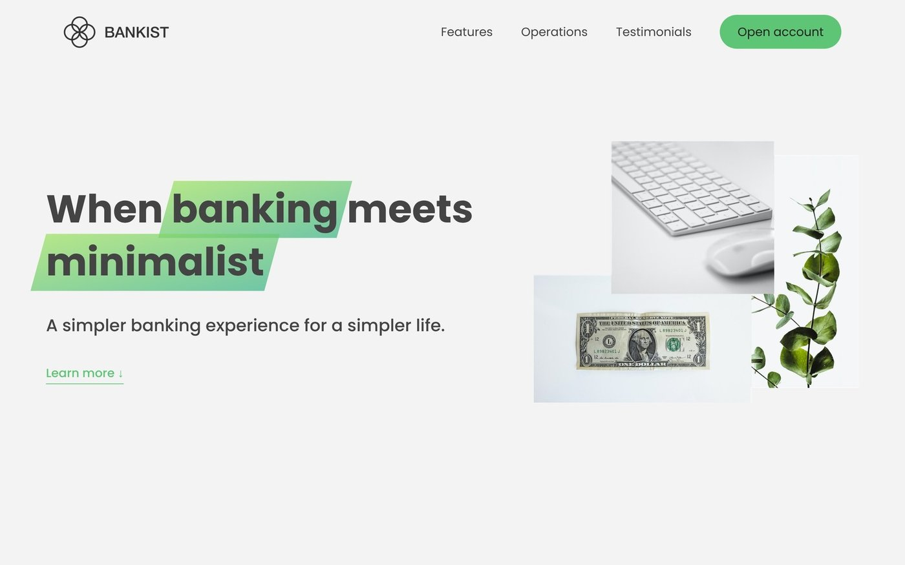
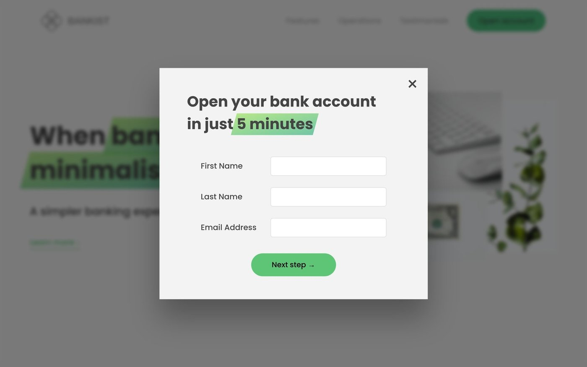
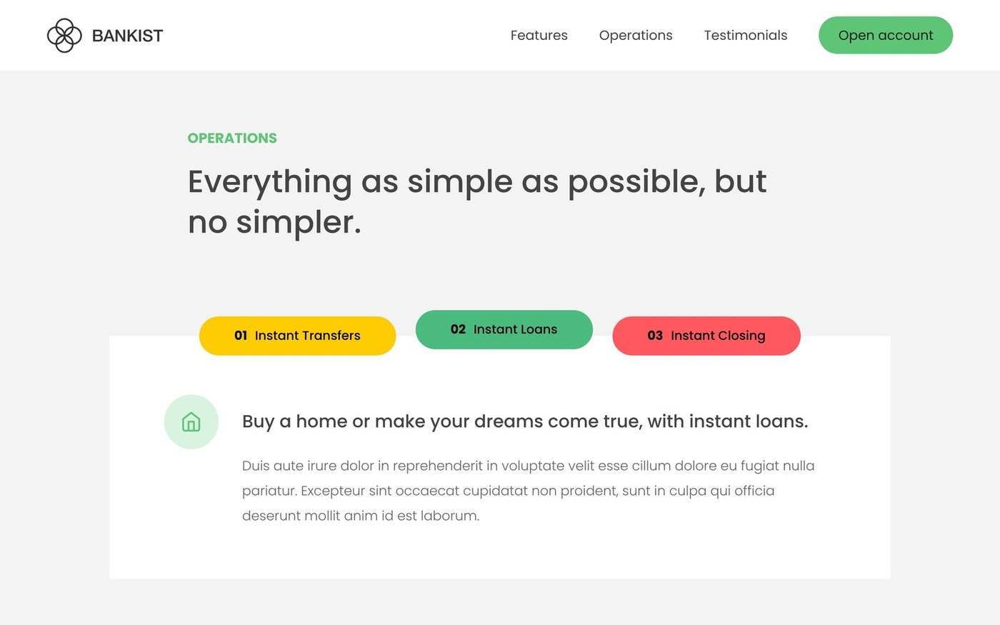

# Bankist

A landing page for a made-up bank, built to practise DOM events and browser APIs in plain JavaScript.

> Built while following a JavaScript course, so it shows what I learned rather than an original design.

## Features

- Modal window for opening an account, with a blurred page behind it
- Smooth scrolling to sections, a tabbed section, and a menu that fades the other links on hover
- Sticky navigation and sections that reveal on scroll, both using the Intersection Observer API
- Lazy-loaded images and a testimonial slider

## Tech

JavaScript (ES6), HTML, CSS. No build step and no dependencies.

## Run

Open `final/index.html` in a browser.

## Author

Harun Kestendžić — [GitHub](https://github.com/harunkestendzic)
